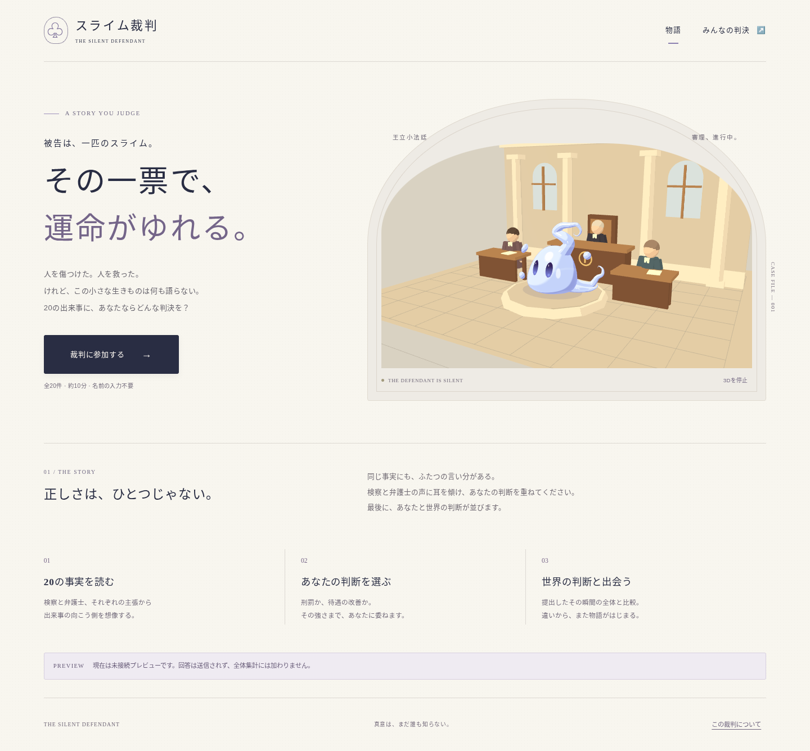

# スライム裁判

突然現れた一匹のスライムを、20件の出来事から裁くブラウザゲーム。スライムは話せず、本当の意図は最後まで明かされません。

Three.jsによる3Dアニメ風の法廷と、添付デザインに基づくスライムを制作する計画です。20件の審理、匿名投票、全体比較、3種類のPNG保存を実装しています。接続設定が空の場合は未送信プレビューとして動作します。

| 資料 | 内容 |
| --- | --- |
| [要件設計案](docs/requirements.md) | 画面、20件の出来事、判決計算、10項目の判断傾向、匿名参加、集計、300文字の小説11本 |
| [実装計画表](docs/superpowers/plans/2026-10-23-slime-trial.md) | 工程・依存関係・成果物・受入条件・検証手順 |
| [3Dアニメ風デザイン仕様](docs/design/3d-art-direction.md) | 添付の立体化、素材、アニメーション、法廷、スマートフォン向けの性能目標 |
| [スライムの参照画像4枚](docs/references/slime/README.md) | 添付原本と各画像の用途 |
| [文書の検証記録](docs/validation/2026-10-23-document-checks.md) | 要件の整合、文字数、画像の同一性、レビューの結果 |

確定した方針と、今回具体化した中間判決・採点式・物語などの案は、要件設計案の中で区別しています。最も重い判決は「悪魔の使いとして公開処刑」、最も優遇する判決は「神の使いとして神殿管理」、合計0は釈放です。

文書の構造・内容・参照画像を検証するには、Python 3で次を実行します。追加パッケージは不要です。

```bash
python3 scripts/validate-docs.py
```

本番Supabaseへの接続と公開は未実施です。変更はPRで確認し、マージは作成者が行います。

## 起動

Node.js 24以上を使用します。

```sh
npm ci
npm run dev
```

[接続・公開・復旧手順](docs/operations.md)にローカルDBと環境変数の設定を記載しています。秘密キーは不要です。匿名の参加情報と編集中の回答は端末へ保存し、個人結果は現在の画面のメモリだけに保持します。

## 検証

```sh
npm run typecheck
npm test
npm run build
```

[DB権限・並行処理の検証](docs/qa/database.md)、[3Dモデル](docs/qa/slime-model.md)、[画面と操作](docs/qa/courtroom.md)、[公開前確認](docs/qa/release-checks.md)を参照してください。実機iPhone Safariや本番環境の確認は、エミュレーションと区別して記録しています。


