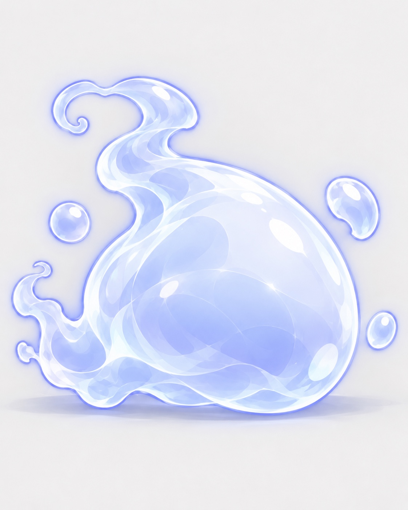
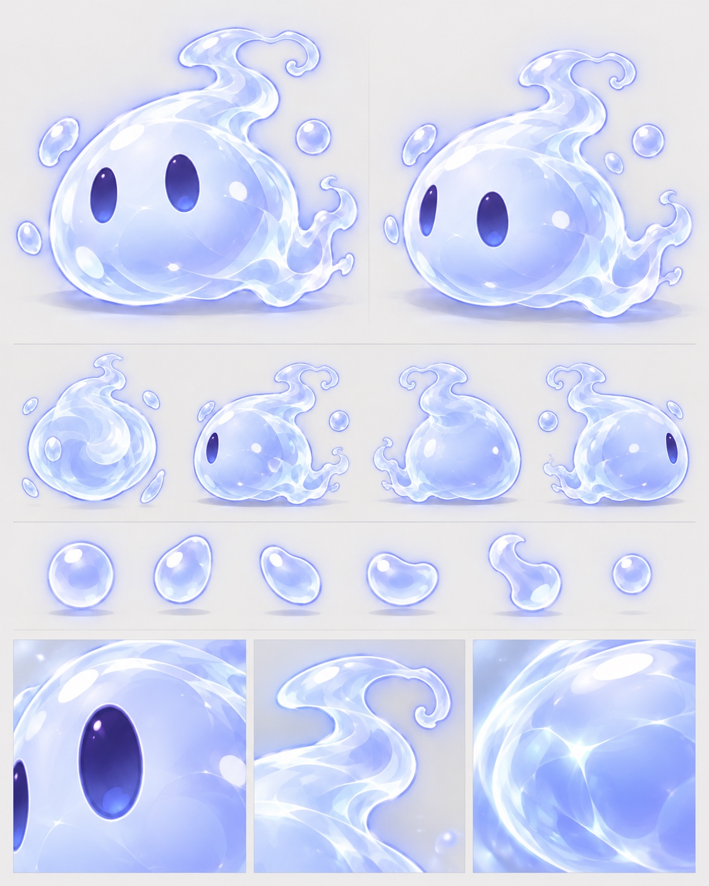

# スライムの参照デザイン

2026-10-23に作成者が添付した4枚を、ファイル名だけ変更して保存しました。リサイズ・再圧縮・背景除去は行っていません。全画像1122×1402pxのJPEGです。白い背景を含む参照画像であり、透過PNGや3Dモデルではありません。

[3D制作仕様](../../design/3d-art-direction.md) · [元ファイル名・SHA-256](manifest.json)

| 用途 | 保存ファイル | 元のファイル名 |
| --- | --- | --- |
| 正面寄りの形、目、色 | [slime-front.jpeg](slime-front.jpeg) | 74D3BAC0-0358-486F-ACC6-EE8EDC7DB39D.jpeg |
| 背面の量感、渦、裾 | [slime-rear.jpeg](slime-rear.jpeg) | E7924B39-6B5C-49BA-8B3A-7BDB6AC2F6A4.jpeg |
| 側面の厚み、目の位置 | [slime-side.jpeg](slime-side.jpeg) | B6F92720-F172-4EEE-BBAC-47BDC3CCC354.jpeg |
| 複数方向、液滴、部位の質感 | [slime-reference-sheet.jpeg](slime-reference-sheet.jpeg) | 547D689A-4805-4522-BFA2-361A71B32709.jpeg |

## 正面寄り

## 背面

## 側面寄り

## 多方向・部位詳細

